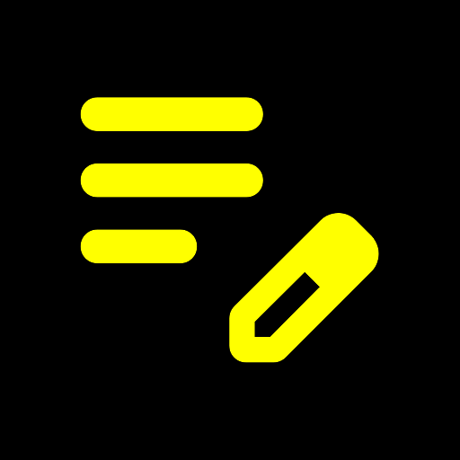

<div align="center">



# 白い熊 メモ

**Fossify Notes in black and pure yellow — themed down to every single element.**

A fork of [Fossify Notes](https://github.com/FossifyOrg/Notes) with **major additions**: the black-yellow look on every surface — outlined pills, pill menus with icons coloured by what a row does, outlined switches — with **every colour a settable role**, a folding UI page with a draggable index, one-ZIP Export/Import of settings **and notes**, headless backup and a clean-phone data restore driven by sister apps, and per-element custom fonts.

Installs **side-by-side** with Fossify Notes (app id `shiroikuma.memo`).

**📥 Latest release: [`1.7.0+021`](https://github.com/ShiroiKuma0/shiroikuma-memo/releases/latest)** — [all releases & APK downloads »](https://github.com/ShiroiKuma0/shiroikuma-memo/releases)

</div>

---

## 🎨 白い熊 メモ UI — every colour is yours

A dedicated **UI page** (the 白い熊 メモ UI row of the ⋮ menu, a long-press on ⋮, or the pill in Settings) where **every colour the app draws is a role you can set** — nothing is pinned in XML. The roles sit in the section of their item: Foundation, Text, Text fields and pickers, Buttons, Dialogs, Switches, Check boxes and radio buttons, Menus, Lists, Top bar, Bars, Notes, Toasts. A button's text, its frame and its ground are three roles; so are a switch's outline and dot, on and off. Each has an alpha-capable picker with a *Default* button, and *Reset all colours* sits in Maintenance.

The page is a **folding accordion**: every section starts folded, a tap on its heading opens it, and a wrapping grid of small chips on top jumps to any section. **Long-press a chip and drag** — the chips reorder live under the finger and the sections follow. Order and fold state are remembered and travel in the export.

---

## 💊 Pills, switches and menus that show what can be pressed

Every action is an **outlined pill**, never a filled slab: the main action of a block has a thick frame and bold text, every other a thin one, and one that deletes turns red. Switches are an outlined pill with a solid dot. The ⋮ menu is a column of **full-width pills, each with an icon coloured by what the row does** — open green, write blue, share orange, lock magenta, delete red — and a › where a row opens something. The same colours mark the rows of the UI page and of Settings, so a menu is read by colour before it is read by word.

---

## 📦 Export / Import — everything, in one ZIP

The first section of the UI page exports and imports the whole app by category — **UI colours**, **Fonts** (including the imported font files themselves), **App settings**, and **the notes themselves** (every note's text, including the content of file-backed ones, plus its type and lock state). It is one archive, never a settings file next to a data file: `shiroikuma-memo_<yyyy-MM-dd_HH-mm-ss>.zip`, the naming every 白い熊 app shares so a single backup directory sorts and reads uniformly. Set an export directory once and exports become one tap; the page shows the timestamp of the latest export in that directory. Import merges (never wipes) — notes are matched by title, so a restore updates them instead of duplicating them — rejects foreign files, and offers an in-place app restart when done.

---

## 🗄️ Headless backup — and a restore that survives a wiped phone (保存復元)

The same export runs **without any UI**, driven by [白い熊 自由作業盤](https://github.com/ShiroiKuma0/shiroikuma-jiyusagyoban): an `EXPORT_STATE` broadcast makes this app write its ZIP and reply with the real path and byte size, so one task backs up every 白い熊 app in a single run. `LIST_CATEGORIES` feeds the caller's checkbox picker with this app's own categories, `items` narrows a run to a subset, `CANCEL_EXPORT` stops a run and deletes its partial file, and progress comes back as **real counts, never a percentage** (「Notes 128/342」). Every archive is written under a `.part` name and renamed into place only once it is complete — so a cancelled or killed export never leaves behind something a later restore would mistake for a backup.

The app also answers a **data door**: a `ContentProvider` at `shiroikuma.memo.automation` through which [白い熊 応用管理](https://github.com/ShiroiKuma0/shiroikuma-oyokanri) backs this app up *with its data* and puts it back on a freshly wiped phone. The caller is identified by exact package name, uid, and a **pinned signing certificate** — never a name prefix, which anyone can take — and the backup travels through a file descriptor the caller opened rather than a path it named. Import lives only here and never on a broadcast: it overwrites every note, and the broadcast surface carries no permission.

The gate ships **open** — the switch is on, the token is optional — because a pasted secret cannot survive the wipe this feature exists to recover from. 「Use authorization token?」 turns the token back on when you want it, and a token sent to an app that is not asking for one is quietly ignored rather than refused. The token is generated on the device, compared in constant time, and excluded from every export, so it can never travel inside a backup.

---

## 🔤 Per-element fonts

Import your own `.ttf`/`.otf` fonts and assign **family, weight, and size per element** — the note text, checklist items, tab titles and headers each get their own typography, with a live sample line while you tune it.

---

## 🖤💛 Black & pure yellow

The default look is solid black `#000000` with **pure yellow `#FFFF00`** — the launcher icon included. The two colours are written once, as the defaults of the role table; framed dialogs, pill buttons and a matching Exporting/Importing flash keep the look consistent everywhere.

---

## 🔓 No nags

Built against a patched Fossify Commons (`7.1.3-sk1`) with the "fake version" / sideloading checks removed — no modded-app dialog even though the app id isn't `org.fossify.*`. The same Commons carries the family's look and its colour roles.

## Built on Fossify Notes

A fork of [Fossify Notes](https://github.com/FossifyOrg/Notes) (app id `shiroikuma.memo`, so it coexists with the official build). Fossify builds excellent open-source, privacy-focused, ad-free apps — all credit for the underlying notes app goes to them. The code remains under the [GPL-3.0 license](LICENSE).

## Building

```bash
git clone git@github.com:ShiroiKuma0/shiroikuma-memo.git
cd shiroikuma-memo
# needs JDK 17+ and the Android SDK; publish the patched commons 7.1.3-sk1 to mavenLocal first
./gradlew buildFoss   # signed foss release → ~/tmp/shiroikuma-memo_<version>_arm64-v8a.apk
```

Versioning: `<upstream version>+<fork build>` with the build counter zero-padded to three digits (e.g. `1.7.0+020`), so builds sort in order; versionCode `upstream*10000+build`.
